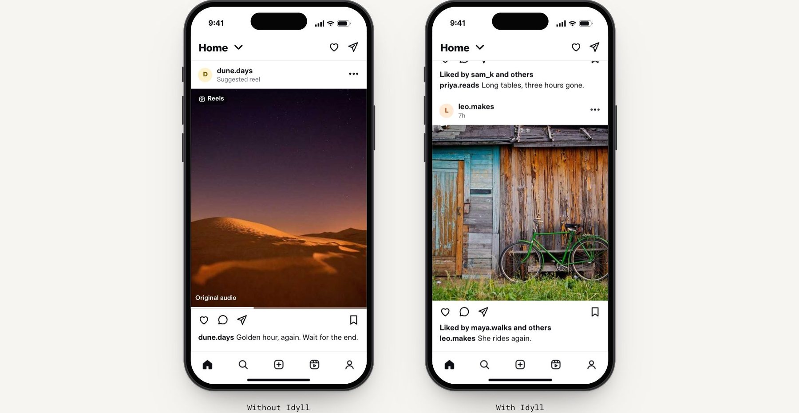

<p align="center"></p>

<h1 align="center">Idyll</h1>

<p align="center"><b>Social, without the scroll.</b><br>The website for Idyll: the feeds out of nine social apps, your friends kept in.</p>

<p align="center">
<a href="https://eoinforker.github.io/idyll-site/">Live site</a> ·
<a href="https://eoinforker.github.io/idyll-site/v2/app/final/final.html">App design</a> ·
<a href="#whats-here">What's here</a> ·
<a href="#working-on-it">Working on it</a>
</p>

<p align="center"></p>

## What it is

The public site for [Idyll](https://github.com/eoinforker/idyll), a free app that takes the ads, Shorts, Reels and algorithmic feeds out of YouTube, Instagram, Facebook, X, Snapchat, TikTok, Reddit, LinkedIn and Threads, and keeps messages, search and whatever a friend sends you.

It is one static page, hand built, with no framework, no build step, no analytics and no cookies. Live at [eoinforker.github.io/idyll-site](https://eoinforker.github.io/idyll-site/) on GitHub Pages until the domain is bought.

Status, 11 October 2026: the home page is final. The apps are not in any store yet, so the page says coming soon.

<p align="center"></p>

## The page

- **Quiet paper, then one loud plate, then night.** Paper and ink with Timeless Sans set tight, a magenta full stop, and underlined links instead of buttons.
- **The plate.** The cygnet is drawn live on a canvas as halftone dots that print on as you arrive. The nine apps' marks are printed the same way and struck through, with what Idyll removes from each.
- **The same feed, twice.** Two phones scroll the same Instagram-style feed at real speed. One never ends. The other ends at You're all caught up.
- **Free. For good.** On the night field, with the trademark line.

It works from 360 to 1920 pixels wide, honours reduced motion, and has no horizontal scroll at any width.

<p align="center"></p>

## What's here

```
index.html          the home page (everything inline: styles, the halftone printer, the phones)
fonts.css, fonts/   Timeless Sans, Timeless Serif and Paper Mono
img/                the app icons (magenta, blue, black), brand marks, photos for the mocks
v2/app/             the app design: four directions and the final design with its engineering spec
v2/                 earlier site directions, kept for reference
v1/                 the first round
```

Photos are from Unsplash via picsum, with no faces. Brand marks are the official ones from Simple Icons, used to name the apps Idyll works with. Idyll isn't affiliated with any of them.

## Working on it

It's static. Serve the folder and open it:

```
python3 -m http.server 8000
```

Changes go live on push to main through GitHub Pages, which caches for about ten minutes.

<p align="center"><sub>Idyll. Social without the scroll. Free, for good.</sub></p>
