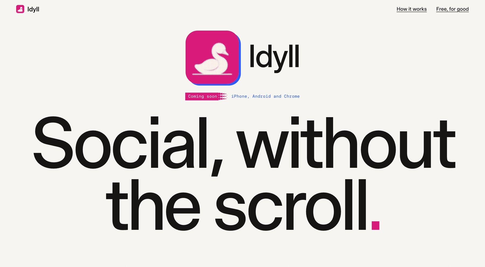
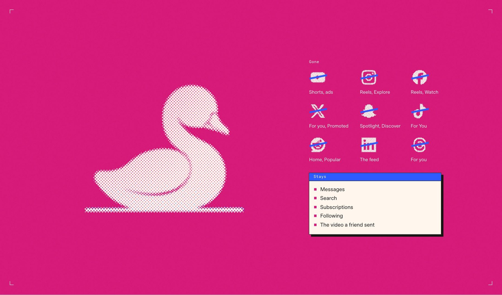
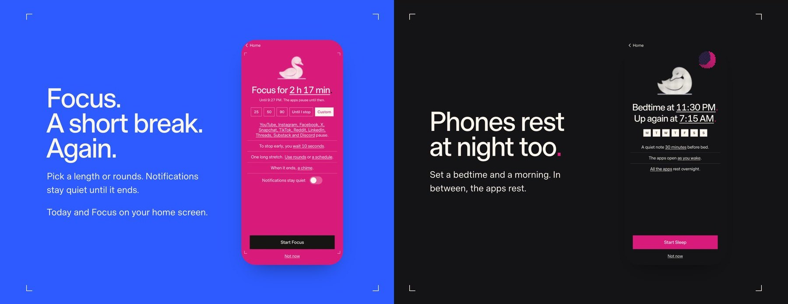

<p align="center"></p>

<h1 align="center">Idyll</h1>

<p align="center"><b>Social, without the scroll.</b><br>The website for Idyll: the feeds out of ten social apps, Discord rested with them, your friends kept in.</p>

<p align="center">
<a href="https://idyll.day/">Live site</a> ·
<a href="https://idyll.day/privacy.html">Privacy</a> ·
<a href="https://idyll.day/support.html">Support</a> ·
<a href="#whats-here">What's here</a> ·
<a href="#working-on-it">Working on it</a>
</p>

<p align="center"></p>

## What it is

The public site for [Idyll](https://github.com/eoinforker/idyll), a free app that takes the short video, the algorithmic feeds and the ads out of YouTube, Instagram, Facebook, X, Snapchat, TikTok, Reddit, LinkedIn, Threads and Substack, keeps messages, search and whatever a friend sends you, and rests Discord along with them during Sleep and Focus.

It is a static page, hand built, with no framework, no build step, no analytics and no cookies, plus a privacy page and a support page. Live at [idyll.day](https://idyll.day/) on GitHub Pages until the domain is bought.

The apps are not in any store yet, so the page says coming soon.

## The page

Four sections, paper first, then one loud plate, then colour, then night.

- **The mark.** The cygnet icon and the name, the Coming soon tag, and Social, without the scroll in Timeless Sans with a magenta full stop.
- **Feed is for swans.** On the magenta plate, a cygnet at the grains is printed live on a canvas as halftone dots, with the grains in a second ink. Beside it, each app's mark is printed the same way and struck through in blue, with what goes from it, and Discord with a lighter strike, paused for Sleep and Focus. Under that, what stays, the two ways in (the real app with a guard, or a clean version in Idyll), and that videos and podcasts keep playing with the phone locked.
- **Focus and Sleep.** Two halves, blue and night, each with a screen rendered from the Android app with sample data.
- **Free. For good.** On the night field, with the Ko-fi link, the privacy promise and the trademark line.

<p align="center"></p>

<p align="center"></p>

It works from 360 to 1920 pixels wide, honours reduced motion, and has no horizontal scroll at any width.

## What's here

```
index.html            the home page (everything inline: styles and the halftone printer)
privacy.html          the privacy policy
support.html          support and the Ko-fi link
fonts.css, fonts/     Timeless Sans, Timeless Serif and Paper Mono
img/                  the app icons, the cygnet poses, brand marks, and the app screens (img/screens)
v2/app/               the app design: four directions and the final design with its engineering spec
v2/, v1/, 1-5 dirs    earlier site directions, kept for reference
docs/                 this README's images and the logo
```

Brand marks are the official ones from Simple Icons (CC0), printed as our own halftone and used only to name the apps Idyll works with. Idyll isn't affiliated with any of them. The screens in `img/screens` are rendered from the Android app's own code (see the app repo's README), so their numbers are sample data.

## Focus together links and app links

`together/` is the page a Focus together link lands on when Idyll isn't on the phone (`https://idyll.day/together#v=1&s=...&e=...&a=...`). Everything after the `#` stays in the browser: the page reads the times there and sends nothing.

`.well-known/assetlinks.json` lets Android open those links straight in Idyll (App Links, `autoVerify`). `.well-known/apple-app-site-association` does the same for iPhone (Universal Links). `.nojekyll` keeps GitHub Pages serving the dot folder.

**TODO (Eóin):**

* **Play App Signing.** Done: `assetlinks.json` holds Google's app signing key and the upload key, so links open Idyll for installs from Play and for local release builds.
* **Apple Team ID.** Replace `TEAMID` in `apple-app-site-association` with the ten character Team ID (developer.apple.com, Membership), so it reads like `ABCDE12345.app.idyll`. The app's entitlement already asks for `applinks:idyll.day`.

## Working on it

It's static. Serve the folder and open it:

```
python3 -m http.server 8000
```

Changes go live on push to main through GitHub Pages, which caches for about ten minutes.

<p align="center"><sub>Idyll. Social without the scroll. Free, for good.</sub></p>
